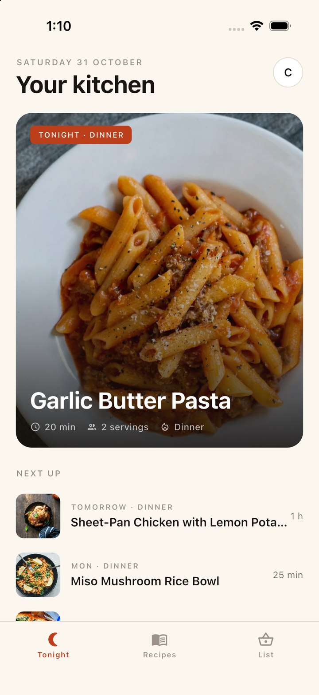
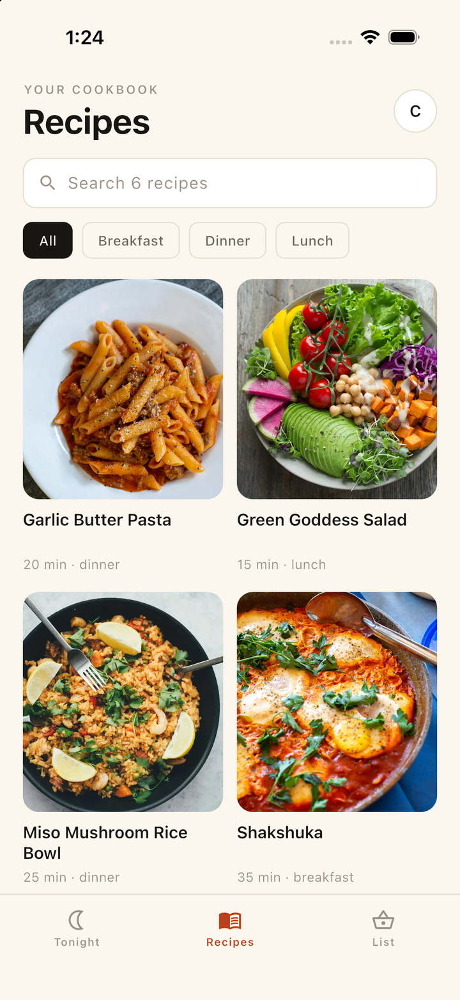
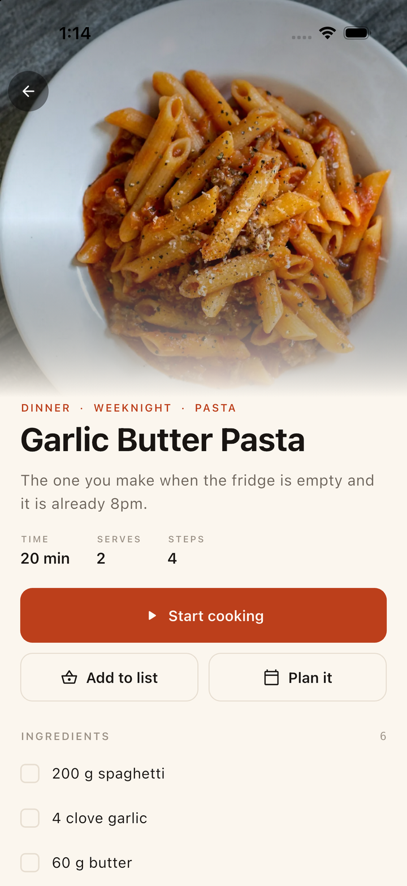
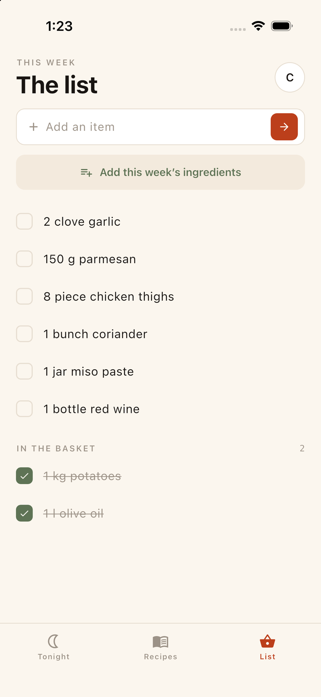
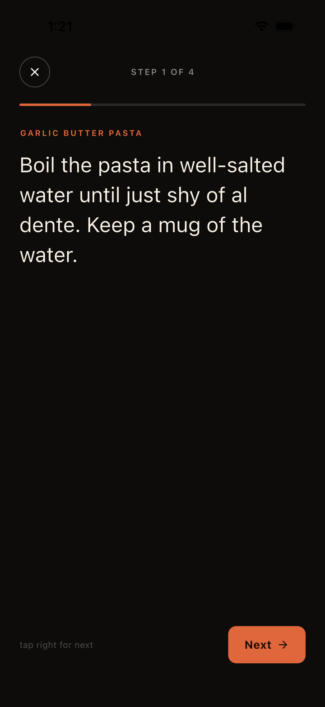

# Mise — a Mealie app for your phone

**Dinner, decided.** A calm, photography-first client for
[Mealie](https://mealie.io), the self-hosted recipe manager and meal planner.
Nothing you don't need on a phone: tonight's dinner, your cookbook, the week's
plan, and the shopping list.

[](LICENSE)
[](https://flutter.dev)
[](#install)
[](CONTRIBUTING.md)

<a href="docs/screenshots/today.png"></a>
<a href="docs/screenshots/recipes.png"></a>
<a href="docs/screenshots/recipe.png"></a>
<a href="docs/screenshots/list.png"></a>
<a href="docs/screenshots/cook.png"></a>

## Why this exists

- Mealie is the best self-hosted recipe manager, and its web UI is excellent —
  on a laptop. On a phone it is a website you have to find, log into, and pinch.
- There is **no official mobile app**. Android's disappeared from Play (users
  asking where it went: [discussion #5339](https://github.com/mealie-recipes/mealie/discussions/5339)),
  and the community answer is the PWA.
- Third-party clients exist and some are good — **Ghee** (free, Flutter, both
  platforms), Meshi Plan, Mealie Go, Mealient (archived 2024), and a long tail of
  iOS apps. This is not an empty field, and pretending otherwise would be silly.
- What is missing is a client that (a) cannot drift into a paywall, because it is
  GPL-3.0 and forkable, and (b) is designed around the twenty minutes you spend
  cooking rather than the ten you spend browsing recipes.

Mise is not affiliated with the Mealie project. It speaks the public v3 API.

## What's in it

**Tonight**
- The day's plan, with tonight's dinner as a full-bleed card.
- The next few days underneath, and the state of the shopping list.

**Cookbook**
- Search and category filters over your recipes, two-up, photography first.
- Recipe page: time, servings, steps, ingredients you can tick off.

**Cook mode**
- One step at a time, 26pt text, black screen, the whole surface is a tap target
  — advance with the back of a knuckle when your hands are covered in flour.

**Shopping**
- Unchecked items, then "in the basket"; swipe to remove.
- **Add this week's ingredients**: pulls every recipe on the next seven days'
  plan into the list in one action.

**Plumbing**
- Sign in with your Mealie email and password. The password is used once for a
  token and never stored; the token does not leave the phone.
- Recipes, plan and list are cached, so the app opens to content on a bad
  connection; pull to refresh.
- Demo mode with six recipes, so the app is reviewable before any server exists.
- No account of ours, no analytics, no third-party SDKs.

## Install

**Android** — APK from [Releases](../../releases):

```bash
adb install app-arm64-v8a-release.apk
```

Also listed on **IzzyOnDroid** and submitted to **F-Droid** — both read the
`fastlane/` tree in this repo, so the description, screenshots and changelog
here are the source of truth (`python3 tool/make_store_metadata.py` regenerates
and validates them).

**iOS** — build from source (no App Store listing yet):

```bash
flutter pub get
flutter run -d <device>
```

Requirements: Flutter 3.44+, iOS 16+, Android 8+, Mealie 2.x/3.x.

### Connecting

Enter your server URL, the email you sign into Mealie with, and your password
(or tap **Look around first** for the demo). Plain `http://` works for LAN
installs — the ATS exception and Android cleartext flag are deliberate.

## Development

```bash
flutter pub get
flutter analyze
flutter run
```

### A real server in one command

```bash
docker run -d --name mealie -p 9000:9000 \
  -e ALLOW_SIGNUP=true -v mealie_data:/app/data \
  ghcr.io/mealie-recipes/mealie:latest
```

Seed it with six recipes, a week of plan entries and a shopping list:

```bash
python3 tool/seed_mealie.py http://127.0.0.1:9000 changeme@example.com MyPassword
```

Mealie's write API has two traps this script encodes: `POST /api/recipes`
creates an empty shell (send a full payload and you silently get a stub called
"1 Cup Flour" — you must `PUT` afterwards), and ingredient references want flat
`unitId`/`foodId` **or** nested `{id, name}` objects, not `{id}` alone.

### Live tests

```bash
MEALIE_URL=http://127.0.0.1:9000 \
MEALIE_EMAIL=changeme@example.com MEALIE_PASS=MyPassword \
flutter test test/live_mealie_test.dart
```

Seven checks: server identity, recipe payload shapes, detail ingredients and
steps, plan entries, a shopping-item check round-trip, add/delete round-trip, and
planning a recipe. They assert **server state after the write**, not the status
code — a 200 that changes nothing is a failure. Skipped when `MEALIE_URL` is
unset, so CI stays offline.

Debug hooks: `--dart-define=CONNECT_URL=...` (sign in without the form),
`--dart-define=START_TAB=1`, `--dart-define=OPEN_RECIPE=<slug>`,
`--dart-define=OPEN_COOK=true`.

### Structure

```
lib/
  mealie.dart       API client (JWT auth, recipes, plan, shopping) + cached store
  theme.dart        ember/charcoal palette, type scale, light + dark
  widgets.dart      recipe photo (auth'd), buttons, fields, date helpers
  screens/
    welcome.dart    server + credentials, demo entry
    shell.dart      three tabs, settings entry
    today.dart      tonight hero, week ahead, list status
    recipes.dart    search, filters, grid
    recipe_detail.dart  hero, stats, ingredients, method
    cook.dart       one-step-at-a-time cooking mode
    shopping.dart   list, add item, pull the week's ingredients
    settings.dart   account, sync, dark mode, about
tool/
  seed_mealie.py    realistic fixture data for a dev instance
  make_icon.py      generates the icon set
```

## Known limits

- Read-only cookbook: no creating or editing recipes in the app. Mealie's editor
  is a desktop job.
- Writes need the network. Checking an item is optimistic and reverts on failure;
  there is no offline queue like a full local-first store would have.
- One shopping list (the household's first). Multi-list support is next.
- No unit conversion, no nutrition, no recipe comments, no household admin.
- Recipe images require the bearer token, so they cannot be shared as plain URLs.
- JWT lifetime is ~48h; when it lapses the app shows a session error and asks you
  to sign in again rather than refreshing silently.
- Tested against **Mealie 3.29.0** (Docker, SQLite) on the iPhone 17 Pro
  simulator — sign-in, sync, detail, plan, list writes. Older 2.x servers should
  work but are untested.

## Contributing

Issues and PRs welcome — see [CONTRIBUTING.md](CONTRIBUTING.md). If Mise earns a
place on your kitchen counter, a star helps other self-hosters find it.

## License

[GPL-3.0](LICENSE). The Mealie name and logo belong to the Mealie project.
